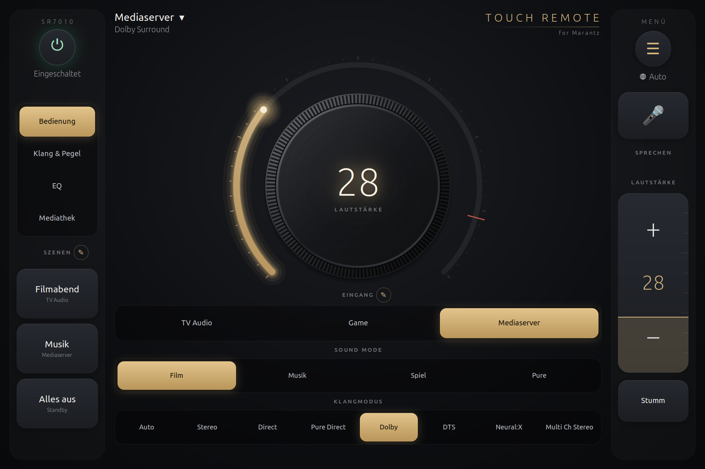
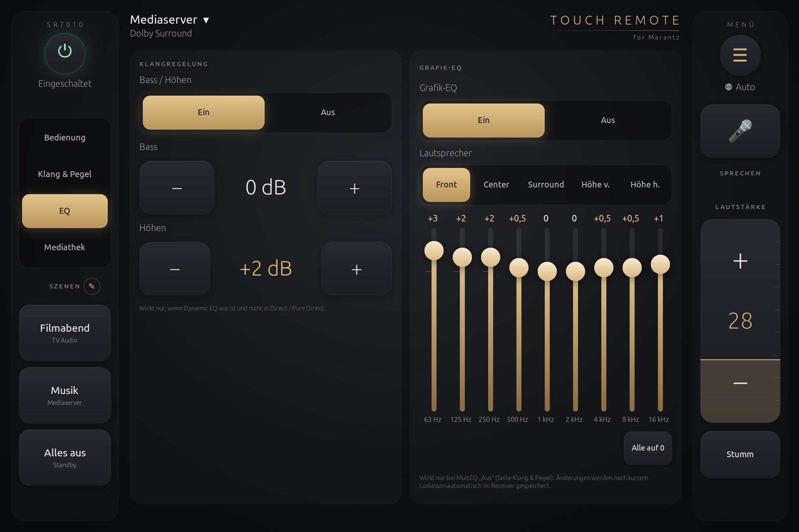
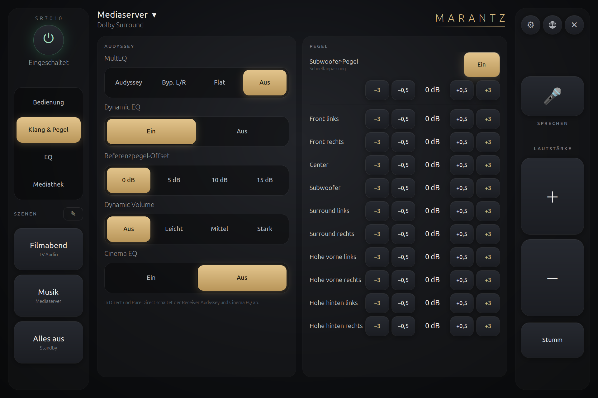

# Touch Remote for Marantz

🇬🇧 [English version](README.md)

Touch-Fernbedienung für Marantz-AV-Receiver (gebaut und getestet mit dem **SR7010**) –
als schlankes Linux-Programm (Python + GTK3).
Entstanden für ein Microsoft Surface 3 mit Linux Mint XFCE, läuft aber auf jedem Linux mit GTK3.

> Inoffizielles Hobbyprojekt – nicht mit Marantz / Sound United verbunden.
> „Marantz“ ist eine Marke des jeweiligen Inhabers.
>
> Gebaut und getestet nur mit dem SR7010; andere Modelle funktionieren vielleicht nur teilweise.
> Das Programm verstellt Lautstärke und Klang am Receiver – **Nutzung auf eigene Gefahr**.



## Funktionen

- **Bedienung:** Ein/Aus, Lautstärke als mattschwarzer Metall-Drehregler (der Rand glüht beim Einstellen), Stumm,
  Sound-Mode-Tasten (Film/Musik/Spiel/Pure) und Klangmodi (Auto, Stereo, Direct, Pure Direct,
  Dolby, DTS, Neural:X, Multi Ch Stereo); Receiver-Modell wird automatisch erkannt
- **Frei belegbar (✎):** drei Szenen-Knöpfe mit eigenem Namen – Eingang, Klangmodus und
  Lautstärke per „Aktuellen Zustand übernehmen“ – und eine Eingangsleiste mit bis zu 5 Eingängen.
  Alle Eingänge des Receivers sind zusätzlich über die Kopfzeile erreichbar.
  Gespeichert in `~/.config/marantz/config.json`
- **Lautstärke-Streifen** rechts für den Daumen: „+“ und „−“ antippen oder gedrückt halten,
  oder senkrecht wischen; Füllstand und Zahl laufen mit dem Drehregler synchron
- **Sicherheit beim Pegel:** Maximum 90, ab 80 sanfter Stopp mit Warnhinweis;
  Wischen am Streifen endet schon bei 60, darüber geht es dort nur schrittweise mit „+“
- **Klang & Pegel:** Audyssey MultEQ, Dynamic EQ + Referenzpegel, Dynamic Volume, Cinema EQ,
  Subwoofer-Pegel, Kanalpegel aller Lautsprecher (±0,5 / ±3 dB)
- **EQ:** Bass/Höhen und **9-Band-Grafik-EQ** pro Lautsprechergruppe
- **Mediathek:** durchsucht einen Plex-Server per UPnP und spielt direkt auf dem Receiver ab –
  mit Cover, Spulen, Warteschlange und lückenlosem Weiterspielen (läuft im Hintergrunddienst weiter)
- **Setup-Menü am Fernseher** per Steuerkreuz
- **Sprachsteuerung (optional, offline)** mit [Vosk](https://alphacephei.com/vosk/):
  „lauter“, „Filmabend“, „Spiele Adele“ …
- **Deutsch und Englisch** – automatisch nach der Systemsprache
- Receiver und Plex-Server werden im Heimnetz **automatisch gefunden** (SSDP / ARP)

| EQ | Klang & Pegel |
|---|---|
|  |  |

## Download

**[⬇ Neueste Version herunterladen](https://github.com/amplifie/touch-remote-for-marantz/releases/latest/download/touch-remote-for-marantz.tar.gz)** (nur für Linux) –
alle Versionen stehen unter [Releases](https://github.com/amplifie/touch-remote-for-marantz/releases).

```bash
tar xzf touch-remote-for-marantz.tar.gz
cd touch-remote-for-marantz
./install.sh
```

## Installation

```bash
sudo apt install python3-gi python3-gi-cairo gir1.2-gtk-3.0   # falls noch nicht vorhanden
./install.sh
```

Danach im Startmenü **„Touch Remote for Marantz“** starten. Das Skript installiert nur für den aktuellen Benutzer
(nach `~/.local/share/marantz-fernbedienung`) und richtet den Hintergrunddienst
`marantz-web` (systemd-User-Dienst) ein. Entfernen: `./uninstall.sh`.

**Sprache:** automatisch (Deutsch, wenn das System auf Deutsch steht, sonst Englisch). Umstellen über den 🌐-Globus oben rechts (Automatisch · Deutsch · English) – oder `"language"` in `~/.config/marantz/config.json`.

**Sprachsteuerung (optional, bisher nur Deutsch):** Vosk-Bibliothek nach `~/.local/share/marantz-voice/lib` und das
Modell `vosk-model-small-de-0.15` nach `~/.local/share/marantz-voice/model` legen – dann erscheint
der 🎤-Knopf. `mic-fix.sh` aktiviert das eingebaute Digitalmikrofon des Surface 3 (rt5645).

## Technik

| Datei | Aufgabe |
|---|---|
| `marantz.py` | Steuerung des Receivers (HTTP-Befehle, Status-XML, Telnet-Abfragen, Grafik-EQ über die Setup-Webseite), Befehls-Whitelist |
| `upnp.py` | Plex-Bibliothek (UPnP ContentDirectory) und Receiver als Abspielgerät (AVTransport) |
| `server.py` | Hintergrunddienst (nur lokal): JSON-API für die App, Wiedergabe-Warteschlange |
| `app.py` | GTK3-Oberfläche fürs Touch-Display |
| `i18n.py` | Übersetzungen Deutsch / Englisch |
| `voice.py`, `sprachbefehle.py` | Offline-Spracherkennung und Befehlsverständnis |

Nur Python-Standardbibliothek + GTK/Cairo – keine weiteren Abhängigkeiten.
Gesendet werden ausschließlich Befehle aus einer festen Liste.

## Lizenz

MIT – siehe [LICENSE](LICENSE).
