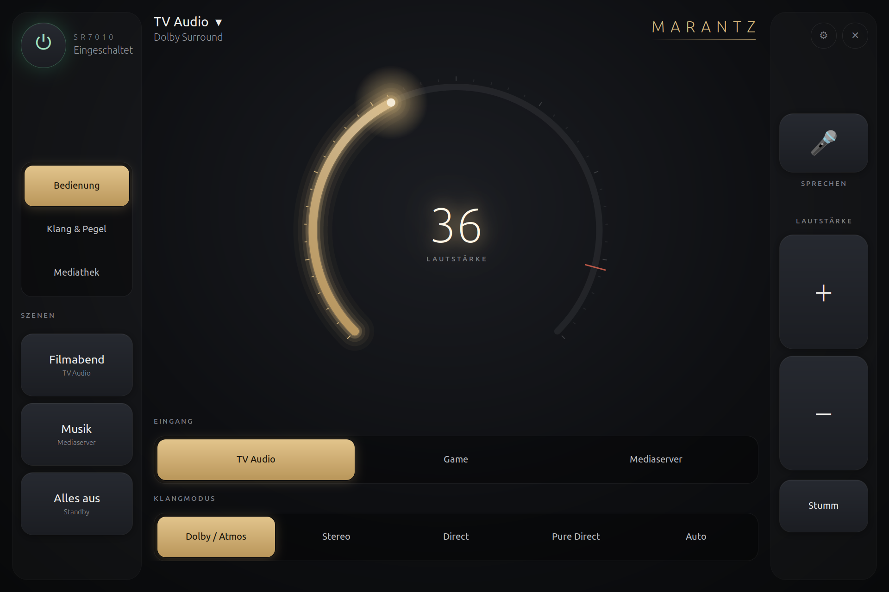
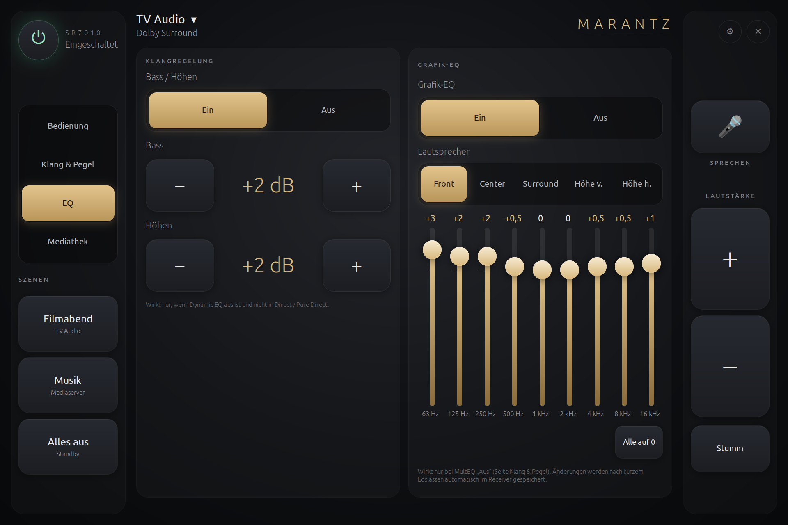
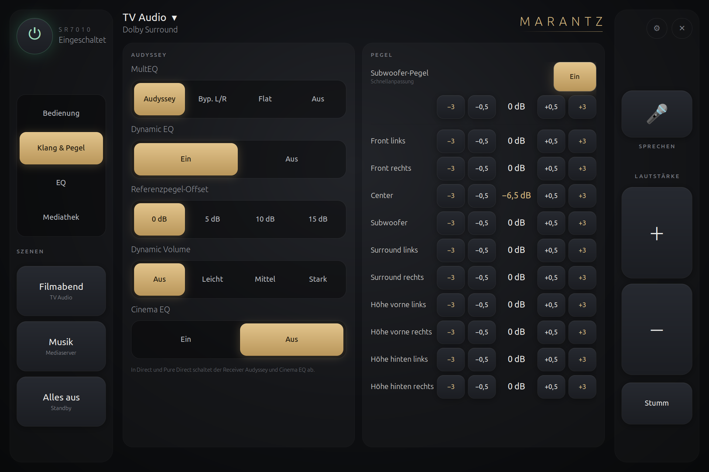

# marantz-touch-remote

Touch-Fernbedienung für Marantz-AV-Receiver (gebaut und getestet mit dem **SR7010**) –
als schlankes Linux-Programm (Python + GTK3) und als Webseite fürs Handy.
Entstanden für ein Microsoft Surface 3 mit Linux Mint XFCE, läuft aber auf jedem Linux mit GTK3.

> Inoffizielles Hobbyprojekt – nicht mit Marantz / Sound United verbunden.
> „Marantz“ ist eine Marke des jeweiligen Inhabers.



## Funktionen

- **Bedienung:** Ein/Aus, Lautstärke als Drehregler (glüht beim Einstellen), Stumm,
  Szenen (z. B. Filmabend, Musik), alle Eingänge des Receivers, Klangmodi
- **Sicherheit beim Pegel:** Maximum 90, ab 80 sanfter Stopp mit Warnhinweis
- **Klang & Pegel:** Audyssey MultEQ, Dynamic EQ + Referenzpegel, Dynamic Volume, Cinema EQ,
  Subwoofer-Pegel, Kanalpegel aller Lautsprecher (±0,5 / ±3 dB)
- **EQ:** Bass/Höhen und **9-Band-Grafik-EQ** pro Lautsprechergruppe
- **Mediathek:** durchsucht einen Plex-Server per UPnP und spielt direkt auf dem Receiver ab –
  mit Cover, Spulen, Warteschlange und lückenlosem Weiterspielen (läuft im Hintergrunddienst weiter)
- **Setup-Menü am Fernseher** per Steuerkreuz
- **Sprachsteuerung (optional, offline)** mit [Vosk](https://alphacephei.com/vosk/):
  „lauter“, „Filmabend“, „Spiele Adele“ …
- **Handy-Webseite** auf Port 8080
- Receiver und Plex-Server werden im Heimnetz **automatisch gefunden** (SSDP / ARP)

| EQ | Klang & Pegel |
|---|---|
|  |  |

## Installation

```bash
sudo apt install python3-gi python3-gi-cairo gir1.2-gtk-3.0   # falls noch nicht vorhanden
./install.sh
```

Danach im Startmenü **„Marantz“** starten. Das Skript installiert nur für den aktuellen Benutzer
(nach `~/.local/share/marantz-fernbedienung`) und richtet den Hintergrunddienst
`marantz-web` (systemd-User-Dienst) ein. Entfernen: `./uninstall.sh`.

**Handy:** `http://<IP-des-Rechners>:8080` – bei aktiver Firewall Port 8080 fürs Heimnetz freigeben.

**Sprachsteuerung (optional):** Vosk-Bibliothek nach `~/.local/share/marantz-voice/lib` und das
Modell `vosk-model-small-de-0.15` nach `~/.local/share/marantz-voice/model` legen – dann erscheint
der 🎤-Knopf. `mic-fix.sh` aktiviert das eingebaute Digitalmikrofon des Surface 3 (rt5645).

## Technik

| Datei | Aufgabe |
|---|---|
| `marantz.py` | Steuerung des Receivers (HTTP-Befehle, Status-XML, Telnet-Abfragen, Grafik-EQ über die Setup-Webseite), Befehls-Whitelist |
| `upnp.py` | Plex-Bibliothek (UPnP ContentDirectory) und Receiver als Abspielgerät (AVTransport) |
| `server.py` | Hintergrunddienst: Webseite, JSON-API, Wiedergabe-Warteschlange |
| `app.py` | GTK3-Oberfläche fürs Touch-Display |
| `index.html` | Handy-Webseite |
| `voice.py`, `sprachbefehle.py` | Offline-Spracherkennung und Befehlsverständnis |

Nur Python-Standardbibliothek + GTK/Cairo – keine weiteren Abhängigkeiten.
Gesendet werden ausschließlich Befehle aus einer festen Liste.

## Lizenz

MIT – siehe [LICENSE](LICENSE).
