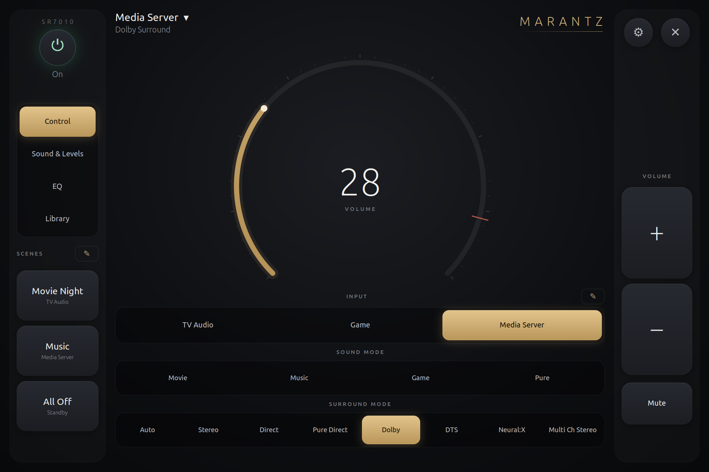
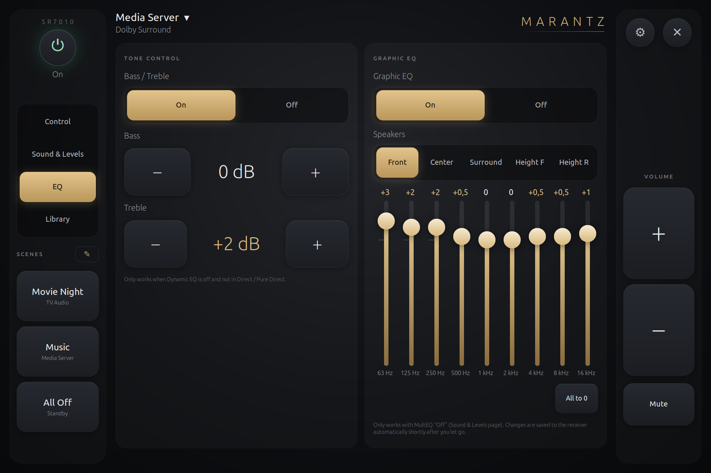
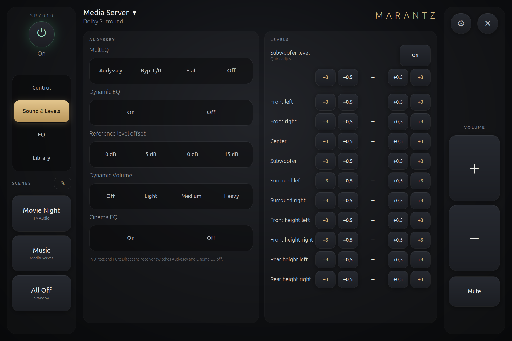

# marantz-touch-remote

🇩🇪 [Deutsche Version](README.de.md)

A touch remote for Marantz AV receivers (built and tested with the **SR7010**) –
as a lightweight Linux app (Python + GTK3) and as a web page for your phone.
Originally made for a Microsoft Surface 3 running Linux Mint XFCE, but it runs on any Linux with GTK3.

> Unofficial hobby project – not affiliated with Marantz / Sound United.
> “Marantz” is a trademark of its respective owner.



## Features

- **Control:** power, volume as a rotary dial (glows while you turn it), mute,
  sound mode buttons (Movie / Music / Game / Pure) and surround modes (Auto, Stereo, Direct,
  Pure Direct, Dolby, DTS, Neural:X, Multi Ch Stereo); the receiver model is detected automatically
- **Customizable (✎):** three scene buttons with your own names – input, surround mode and volume
  via “Use current settings” – and an input bar with up to 5 inputs.
  All receiver inputs are also available from the header.
  Stored in `~/.config/marantz/config.json` (also used by the phone web page)
- **Volume safety:** maximum 90, soft stop with a warning at 80
- **Sound & Levels:** Audyssey MultEQ, Dynamic EQ + reference level, Dynamic Volume, Cinema EQ,
  subwoofer level, channel levels of all speakers (±0.5 / ±3 dB)
- **EQ:** bass/treble and a **9-band graphic EQ** per speaker group
- **Library:** browses a Plex server via UPnP and plays directly on the receiver –
  with cover art, seeking, queue and gapless playback (keeps playing in the background service)
- **Setup menu on the TV** via an on-screen D-pad
- **Phone web page** on port 8080
- **English and German** – chosen automatically from the system / phone language
- Receiver and Plex server are **found automatically** on the home network (SSDP / ARP)
- Optional **offline voice control** (German) with [Vosk](https://alphacephei.com/vosk/)

| EQ | Sound & Levels |
|---|---|
|  |  |

## Installation

```bash
sudo apt install python3-gi python3-gi-cairo gir1.2-gtk-3.0   # if not installed yet
./install.sh
```

Then start **“Marantz”** from the menu. The script installs for the current user only
(to `~/.local/share/marantz-fernbedienung`) and sets up the background service
`marantz-web` (systemd user service). Remove with `./uninstall.sh`.

**Phone:** open `http://<IP-of-the-computer>:8080` – if a firewall is active, allow port 8080
for your home network.

**Language:** automatic (German if the system is set to German, otherwise English).
To force one, add `"language": "en"` or `"language": "de"` to `~/.config/marantz/config.json`.

**Voice control (optional, German only for now):** put the Vosk library into
`~/.local/share/marantz-voice/lib` and the model `vosk-model-small-de-0.15` into
`~/.local/share/marantz-voice/model` – then the 🎤 button appears.
`mic-fix.sh` enables the built-in digital microphone of the Surface 3 (rt5645).

## How it works

| File | Purpose |
|---|---|
| `marantz.py` | Receiver control (HTTP commands, status XML, telnet queries, graphic EQ via the setup web page), command whitelist |
| `upnp.py` | Plex library (UPnP ContentDirectory) and the receiver as a renderer (AVTransport) |
| `server.py` | Background service: web page, JSON API, playback queue |
| `app.py` | GTK3 touch interface |
| `i18n.py` | English / German translations |
| `index.html` | Phone web page |
| `voice.py`, `sprachbefehle.py` | Offline speech recognition and command parsing (German) |

Python standard library + GTK/Cairo only – no other dependencies.
Only commands from a fixed list are ever sent to the receiver.

## License

MIT – see [LICENSE](LICENSE).
